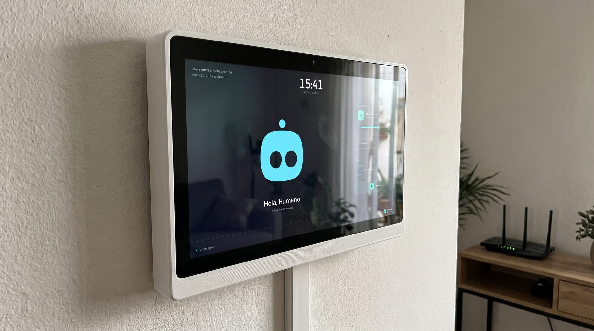
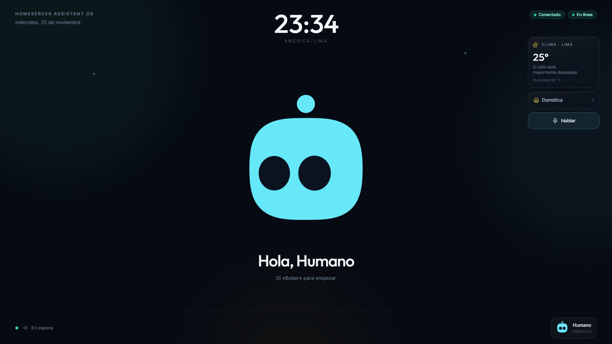
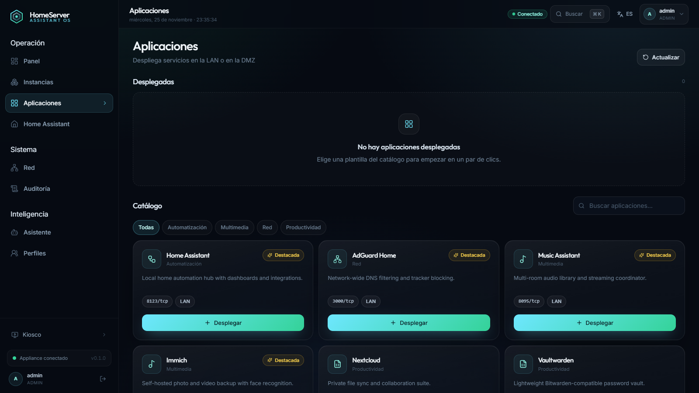
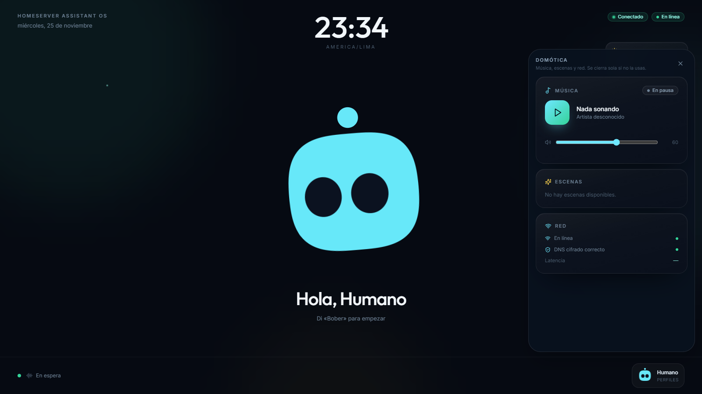

# HomeServer Assistant OS

[](https://github.com/jackby03/homeserver-assistant/actions/workflows/ci.yml)
[](LICENSE)

**Repositorio:** https://github.com/jackby03/homeserver-assistant

**Un home server de código abierto, local-first, instalable desde una ISO y
pensado para vivir montado en la pared.** Combina un panel web de administración,
virtualización con Incus (contenedores LXC, contenedores OCI y VMs), DNS cifrado
con filtrado, firewall con DMZ aislada, Home Assistant, un agente de IA con
herramientas y una interfaz táctil tipo HomePod/Echo Show con avatar animado y
visión 100 % local.

> **Estado:** MVP funcional verificado en el entorno de desarrollo. Backend Rust
> con **400+ tests**, `clippy -D warnings` limpio, UI compilada y probada,
> infraestructura/ISO validada estáticamente (su ejecución real requiere Linux).
> Ver [Estado del proyecto](#estado-del-proyecto).

> **Idioma:** la documentación principal está en español; el código, los
> comentarios, los logs y los mensajes de consola están en inglés (regla de
> `AGENTS.md`). La UI está internacionalizada en `es` (por defecto) y `en`.

---

## Capturas



*Concepto de instalación en pared. Las siguientes capturas son del entorno de
desarrollo con datos de demostración.*

| Kiosko de pared | Administración |
|:---:|:---:|
| [](docs/screenshots/kiosk.png) | [](docs/screenshots/admin-apps.png) |
|  | Panel de aplicaciones, perfiles, red, DNS, firewall e integraciones.<br><br>El kiosko muestra el clima local, la música, las escenas de Home Assistant y el estado del asistente. |

Más capturas y notas en [`docs/screenshots/`](docs/screenshots/).

---

## Tabla de contenidos

1. [Capturas](#capturas)
2. [Qué incluye](#qué-incluye)
3. [Arquitectura en 30 segundos](#arquitectura-en-30-segundos)
4. [Stack técnico](#stack-técnico)
5. [Estructura del repositorio](#estructura-del-repositorio)
6. [Desarrollo rápido](#desarrollo-rápido)
7. [Verificación del repositorio](#verificación-del-repositorio)
8. [Primer arranque](#primer-arranque)
9. [Integraciones externas](#integraciones-externas)
10. [Seguridad](#seguridad)
11. [Puertos y servicios](#puertos-y-servicios)
12. [Configuración y datos](#configuración-y-datos)
13. [Estado del proyecto](#estado-del-proyecto)
14. [Documentación](#documentación)
15. [Contribuir y soporte](#contribuir-y-soporte)
16. [Licencia](#licencia)

---

## Qué incluye

### Panel de administración (HTTPS + login)

- **Dashboard**: CPU, RAM, discos (ZFS/Btrfs), temperatura, batería/UPS,
  tráfico de red y salud de servicios, en tiempo real por WebSocket.
- **Cómputo**: listar/crear/iniciar/parar/reiniciar/eliminar instancias de
  Incus (LXC, OCI/Docker y VMs QEMU/KVM), límites de CPU/RAM, snapshots y
  restauración en un clic, logs y terminal web.
- **Apps**: catálogo de plantillas (Home Assistant, AdGuard Home, Music
  Assistant, Immich, Nextcloud, Vaultwarden, Uptime Kuma, n8n), despliegue en
  `LAN` o `DMZ`, variables de entorno, subdominio y proxy inverso.
- **Home Assistant + IoT**: aprovisionamiento, estado, entidades, escenas y
  adopción de dispositivos descubiertos por mDNS/SSDP/ARP.
- **Red y seguridad**: IP estática/DHCP, **catálogo de 40 variantes DNS gratuitas**
  (default **Cloudflare Family**; Cloudflare, Google, AdGuard, Quad9, CleanBrowsing, OpenDNS, NextDNS, Comodo,
  Control D con 13 listas comunitarias, DNS.WATCH o custom) con IPv4/IPv6,
  **DoH/DoT** (y DNS sin cifrar solo para proveedores heredados), listas de
  bloqueo, subred DMZ con `nftables` (aislada de la LAN y del puerto de
  administración pero con salida a Internet enmascarada para actualizaciones y
  túneles), y túneles salientes (Cloudflare Tunnel / WireGuard).
- **IA y perfiles**: proveedores OpenAI, Anthropic, DeepSeek, opencode-go y
  endpoints compatibles, claves cifradas, herramientas con permisos por perfil,
  workflows tipo nodo y perfiles familiares con avatar y biometría local.
- **Voz en el kiosko**: wake word continuo «Bober» con Wyoming/Vosk, STT local
  (Vosk/faster-whisper), Piper local y micrófono de Chrome; sin depender de la
  interfaz PortAudio/WDM del host de desarrollo.
- **Asistente local-first**: router de comandos en español que resuelve sin IA
  la hora/fecha, el clima actual de Lima u otra ciudad vía Open-Meteo, el
  bienestar, volumen, música, luces y escenas de Home Assistant, cálculos,
  chistes, identidad y ayuda. Solo las preguntas que no cubre pasan al
  LLM configurado (con permisos por perfil también para las acciones locales).
  El clima es la única llamada saliente de este router y solo se hace cuando
  el usuario pregunta por el tiempo; no se envía audio ni datos personales.
- **Asistente de voz siempre activo**: se activa llamándolo por su nombre (nombre
  personalizable, por defecto `Bober`), con sensibilidad, ventana de escucha y
  modo nombre/botón configurables; el reconocimiento de voz y las transcripciones
  se procesan **100 % en local**.

### Kiosko de pared (pantalla completa)

- **Avatar BoopFace (MIT)**: ojos y expresiones reactivas (escucha, piensa, habla), gestos de cabeza y seguimiento del puntero, con color/ojos por perfil.
- **Avatar SVG animado** con siluetas `circle`, `squircle`, `cloud`, `cone`,
  `droplet` y dos ojos en cápsula; color, color de ojos e inclinación
  configurables por perfil.
- **Estados reactivos**: `idle`, `tracking` (los ojos siguen a la persona con
  coordenadas normalizadas), `listening`, `thinking`, `speaking` y
  `profile_switch` al reconocer a un miembro de la familia (el helper local
  calcula el embedding y `POST /kiosk/recognize` hace el matching y activa el
  perfil).
- **Controles rápidos**: música al equipo de sonido, escenas/luces de Home
  Assistant, actividad del agente y estado de red.
- **Wizard de primer arranque de 6 pasos**, también accesible desde el móvil o
  el PC de la LAN.

### Visión y audio locales

- `hs-vision` (Rust) lee la cámara, detecta movimiento/persona y emite
  coordenadas `(x, y)` normalizadas por un socket Unix. **Los fotogramas nunca
  salen del dispositivo ni se guardan.**
- Reconocimiento facial opcional con InsightFace local para generar embeddings;
  la comparación y el umbral viven en Rust (`hs-profiles`) y los embeddings se
  guardan cifrados.
- Audio vía PipeWire/WirePlumber con salida al equipo de sonido externo (jack,
  USB DAC o Bluetooth).

---

### Personalidad de Bober (SOUL.md)

La identidad estable del asistente vive en [`SOUL.md`](SOUL.md): carácter,
estilo de voz, criterio para usar herramientas, límites de seguridad y ejemplos.
El prompt de ejecución lo combina con el perfil activo, el idioma, el tono, la
hora local y las reglas de seguridad; el contexto de ejecución manda si hay
conflicto.

Al arrancar, el daemon copia el SOUL por defecto a `data/SOUL.md` si no existe.
Para cambiar la personalidad en una instalación concreta, edita
`data/SOUL.md` y reinicia el daemon. El archivo no contiene secretos.

## Arquitectura en 30 segundos

Cuatro planos acoplados por APIs locales, un solo demonio privilegiado:

```
┌─────────────────────────────────────────────────────────────────────┐
│ 4 · Inteligencia: agente LLM + herramientas + perfiles + visión     │
├─────────────────────────────────────────────────────────────────────┤
│ 3 · Red/seguridad/IoT: DNS DoH/DoT, nftables, DMZ, Home Assistant   │
├─────────────────────────────────────────────────────────────────────┤
│ 2 · Cómputo: RuntimeProvider + Incus (LXC/OCI/VMs) + despliegue     │
├─────────────────────────────────────────────────────────────────────┤
│ 1 · Host: métricas, energía, audio, cámara, persistencia, auth      │
└─────────────────────────────────────────────────────────────────────┘
             todo compuesto por hs-daemon (Rust, systemd)
```

- `hs-daemon` escucha **solo en loopback**: API admin `127.0.0.1:8080` y kiosko
  `127.0.0.1:3000`. **Caddy** termina TLS en `:8443` y sirve el portal con CA
  local.
- 13 crates Rust con fronteras estrictas y puertos/adaptadores; `hs-core` es
  hoja. Ver [`docs/ARCHITECTURE.md`](docs/ARCHITECTURE.md).
- UI React + TypeScript estricto + Tailwind, una sola SPA con tres
  experiencias: `/setup`, `/admin`, `/kiosk`.

---

## Stack técnico

| Capa | Tecnología |
|---|---|
| Backend | Rust 2021 (tokio, axum, tower, redb, serde, tracing) |
| Auth | Argon2id, JWT HS256 propio, sesiones revocables, RBAC, CSRF |
| Cómputo | Incus REST sobre socket Unix (LXC, OCI, QEMU/KVM, ZFS/Btrfs) |
| Red | nftables, AdGuard Home o Technitium, DoH/DoT, Caddy, Cloudflare Tunnel/WireGuard |
| Domótica | Home Assistant REST + descubrimiento mDNS/SSDP/ARP |
| IA | Adaptadores OpenAI-compatible + Anthropic, tool calling, workflows |
| Visión | Rust + V4L2; helper Python opcional (InsightFace) para embeddings |
| UI | React 19, TypeScript strict, Vite, Tailwind |
| Empaquetado | Ubuntu 24.04 autoinstall + xorriso + QEMU smoke test |

---

## Estructura del repositorio

```text
homeserver-assistant/
├── AGENTS.md                    # reglas de ingeniería y seguridad (obligatorias)
├── Cargo.toml                   # workspace Rust (13 crates)
├── Makefile                     # build-daemon, build-ui, build-vision, test, iso…
├── CHANGELOG.md / CONTRIBUTING.md
├── .github/workflows/ci.yml     # CI: fmt, clippy, tests, UI, scripts
├── crates/
│   ├── hs-core/                 # config, modelos, redb, vault, eventos
│   ├── hs-auth/                 # Argon2id, JWT, sesiones, RBAC, CSRF, auditoría
│   ├── hs-system/               # métricas, energía, audio, cámara/táctil
│   ├── hs-runtime/              # RuntimeProvider + Incus + MockRuntime
│   ├── hs-apps/                 # catálogo y despliegue de aplicaciones
│   ├── hs-network/              # DNS DoH/DoT, nftables, DMZ, netplan
│   ├── hs-discovery/            # mDNS, SSDP/UPnP, ARP + OUI
│   ├── hs-homeassistant/        # cliente REST y aprovisionamiento
│   ├── hs-agent/                # adaptadores LLM y bucle agéntico
│   ├── hs-tools/                # registro de herramientas, permisos, workflows
│   ├── hs-profiles/             # perfiles, avatares, biometría local
│   ├── hs-vision/               # servicio de seguimiento local (+ binario)
│   └── hs-daemon/               # API HTTP/WS, kiosko, adaptadores y composition root
├── ui/                          # SPA React (wizard, admin, kiosko)
├── voice/                       # listener local de wake word (STT local opcional)
├── vision/python/               # helper opcional InsightFace (local)
├── infra/                       # incus preseed, nftables, systemd, servicios
├── iso/                         # autoinstall Ubuntu + build-iso.sh + test QEMU
├── docs/                        # arquitectura, API, seguridad, despliegue, ADRs
└── scripts/                     # instalador y validadores de assets
```

---

## Desarrollo rápido

Requisitos: **Rust 1.85+**, **Node 22+**, **pnpm 9+**. Para Incus/nftables/ISO
hace falta Linux; en Windows/macOS el daemon corre con `--dev` usando fakes.

```bash
# 1) Dependencias (una vez; luego se puede compilar offline)
cargo fetch
cd ui && pnpm install && cd ..

# 2) Calidad del backend
cargo fmt --all -- --check
cargo clippy --workspace --all-targets --offline -- -D warnings
cargo test --workspace --offline --lib --tests

# 3) UI: type-check, tests y build de producción
cd ui && pnpm typecheck && pnpm test && pnpm build && cd ..

# 4) Assets de infraestructura/ISO
python3 scripts/check-assets.py

# 5) Daemon en modo desarrollo (runtime y hardware simulados)
cargo run -p hs-daemon --offline -- serve --dev \
  --data-dir ./.hs-data --static-dir ui/dist
#   API admin:  http://127.0.0.1:8080
#   Kiosko:     http://127.0.0.1:3000/kiosk

# 6) UI en modo desarrollo (opcional)
cd ui && pnpm dev     # Vite en :5173 con proxy a :8080

# 7) ISO instalable (solo Linux, requiere xorriso)
make iso && make test-vm
```

Más detalles en [`docs/DEVELOPMENT.md`](docs/DEVELOPMENT.md).

---

## Verificación del repositorio

Resultados de la última ejecución en el entorno de desarrollo (Windows):

| Comprobación | Resultado |
|---|---|
| `cargo test --workspace --offline --lib --tests` | **442 tests, 0 fallos** (17 binarios de test) |
| `cargo clippy --workspace --all-targets -- -D warnings` | limpio |
| `cargo fmt --all -- --check` | limpio |
| `pnpm typecheck` / `pnpm test` / `pnpm build` | limpio / 20 tests / `ui/dist` 0,91 MB |
| `python3 scripts/check-assets.py` | 75 comprobaciones, 0 fallos |
| Smoke del daemon real (`serve --dev`) | `/api/v1/health`, `/setup/status`, UI admin y `/kiosk` con cookie responden 200 |
| ShellCheck de los scripts (por el agente de infraestructura) | 0 avisos en 7 scripts |
| ISO/QEMU, `nft -c`, `netplan apply`, Incus real | requieren un host Linux; comandos documentados en `docs/ISO.md` |

Los tests cubren seguridad (JWT manipulado, CSRF, RBAC, bloqueo de login,
re-vocación de sesiones, aislamiento DMZ, permisos de herramientas), persistencia
cifrada, degradación de servicios y los flujos HTTP completos del daemon.

---

## Primer arranque

1. Arranca la ISO en el portátil/pantalla de pared. El sistema instala,
   provisiona Incus y arranca `hs-daemon`, `hs-vision` y el kiosko.
2. Abre `https://<ip-del-servidor>:8443` desde el móvil o el PC y acepta la CA
   local (instrucciones en [`docs/DEPLOYMENT.md`](docs/DEPLOYMENT.md)).
3. El **wizard de 6 pasos** configura: cuenta de administrador e idioma, red +
   DNS cifrado + DMZ, audio/táctil/cámara, descubrimiento IoT, proveedor de IA y
   perfiles familiares, y por último despliega los servicios con progreso en
   vivo.
4. Al terminar, `initialized = true` y el kiosko toma la pantalla completa.

---

## Integraciones externas

Calendario y correo son **opt-in** y pasan por un gateway de capacidades con
riesgo explícito, confirmación para escrituras, API key cifrada y allowlist de
acciones. El modelo de amenazas y los límites están en
[`docs/AGENT_CAPABILITIES.md`](docs/AGENT_CAPABILITIES.md). El POC se validó con
un gateway Composio simulado; para producción faltan OAuth y credenciales reales.

## Seguridad

Resumen (detalle completo en [`docs/SECURITY.md`](docs/SECURITY.md)):

- Contraseñas **Argon2id**; sesiones JWT con registro servidor y revocación
  inmediata; cookies `HttpOnly` + `SameSite=Strict`; **CSRF** obligatorio para
  peticiones mutantes con cookie; bloqueo de fuerza bruta.
- **RBAC** `admin` / `operator` / `viewer` comprobado en rutas y servicios.
- Secretos (API keys, tokens, biometría) cifrados con **ChaCha20-Poly1305**;
  clave maestra en `master.key` con permisos `0600`.
- **DMZ aislada** por `nftables`: sin ruta a la LAN ni al puerto de
  administración; reglas con tests golden.
- **TLS terminado en Caddy** con CA local; el demonio nunca se expone a la LAN.
- Visión y biometría 100 % locales; el agente solo ejecuta herramientas
  permitidas explícitamente en el perfil activo.

---

## Puertos y servicios

| Puerto | Bind | Servicio |
|---|---|---|
| `8443/tcp` | LAN | Caddy: portal de administración (TLS, CA local) |
| `8080/tcp` | `127.0.0.1` | API REST/WS del daemon |
| `3000/tcp` | `127.0.0.1` | Kiosko (UI + API de kiosko) |
| `53/udp,tcp` | LAN | AdGuard Home (DNS filtrado) |
| `8123/tcp` | LAN | Home Assistant |
| `22/tcp` | LAN (opcional) | SSH (deshabilitado por defecto en la ISO) |
| socket Unix | — | `/run/homecore/vision.sock` |

---

## Configuración y datos

- Directorio de datos: `/var/lib/homecore` (`HS_DATA_DIR` para cambiarlo).
  - `config.json` — configuración validada y versionada.
  - `state.redb` — usuarios, sesiones, perfiles, apps, proveedores, workflows,
    auditoría y secretos cifrados.
  - `master.key` — clave maestra del vault (¡backup offline!).
- Variables de entorno: `HS_DATA_DIR`, `HS_ADMIN_BIND`, `HS_KIOSK_BIND`,
  `HS_STATIC_DIR`, `HS_VISION_SOCKET`, `HS_CADDY_APPS_DIR`, `HS_CADDY_ENV_FILE`,
  `RUST_LOG`.
- Reset de desarrollo: `make reset-dev` (borra `./.hs-data`).

---

## Estado del proyecto

| Área | Estado |
|---|---|
| Núcleo, configuración, persistencia cifrada | ✅ Implementado y probado (redb + ChaCha20-Poly1305) |
| Autenticación, RBAC, CSRF, auditoría | ✅ Implementado y probado (Argon2id, JWT con revocación) |
| API admin + kiosko, wizard, WebSockets | ✅ Implementado; suite de integración HTTP |
| Motor Incus, snapshots, apps | ✅ Adaptador nativo + mock; validación real en host Linux |
| Despliegue de apps con Caddy | ✅ Snippets `apps.d` por app, recarga automática |
| DNS DoH/DoT, nftables, DMZ, netplan | ✅ Catálogo de 40 variantes, renderizado/golden tests; aplicación real en Linux |
| Home Assistant + descubrimiento IoT | ✅ Implementado con transportes simulados en tests |
| Asistente de voz local (wake word) | ✅ Nombre configurable, matcher Rust con tests, helper STT local opcional, respuestas sin emojis para TTS |
| Agente IA, herramientas, workflows, perfiles | ✅ 20 herramientas, SOUL.md editable, memoria, timers, noticias RSS, calendario/correo opt-in y trazas |
| Visión local | ✅ Seguimiento en Rust + helper Python opcional + matching en daemon |
| UI (admin, kiosko, wizard) | ✅ Type-check, 20 tests y build de producción |
| Infraestructura, systemd, ISO, QEMU | 🟡 Plantillas y scripts validados; build/prueba real en host Linux |
| TLS nativo en el daemon | ❌ Decisión de diseño: lo termina Caddy (ver ADR 0003) |
| Terminal PTY interactiva en Incus | 🟡 Ejecución de comandos uno-a-uno por WebSocket; PTY pendiente |
| Actualizaciones OTA firmadas | 🟡 Documentado como mantenimiento manual; canal OTA pendiente |

---

## Documentación

- [`docs/ARCHITECTURE.md`](docs/ARCHITECTURE.md) — planos, crates, flujos, datos.
- [`docs/API.md`](docs/API.md) — referencia REST/WS.
- [`docs/SECURITY.md`](docs/SECURITY.md) — modelo de amenazas y controles.
- [`docs/DEPLOYMENT.md`](docs/DEPLOYMENT.md) — hardware, instalación, TLS, backups.
- [`docs/ISO.md`](docs/ISO.md) — construcción y prueba de la ISO.
- [`docs/DEVELOPMENT.md`](docs/DEVELOPMENT.md) — entorno de desarrollo y tests.
- [`docs/PUBLISHING.md`](docs/PUBLISHING.md) — publicación, releases y checklist GPLv3.
- [`voice/README.md`](voice/README.md) — wake word local y STT sin nube.
- [`docs/adr/`](docs/adr/) — decisiones de arquitectura.
- [`AGENTS.md`](AGENTS.md) — reglas de ingeniería para humanos y agentes de IA.
- [`CONTRIBUTING.md`](CONTRIBUTING.md) — flujo de contribución y DCO.
- [`CODE_OF_CONDUCT.md`](CODE_OF_CONDUCT.md) — normas de convivencia.
- [`SECURITY.md`](SECURITY.md) — cómo reportar vulnerabilidades.
- [`THIRD_PARTY_NOTICES.md`](THIRD_PARTY_NOTICES.md) — licencias de componentes externos.
- [`ROADMAP.md`](ROADMAP.md) — próximos hitos del proyecto.

---

## Contribuir y soporte

Este proyecto se publica bajo GPLv3 y busca crecer con la comunidad:

- [`CONTRIBUTING.md`](CONTRIBUTING.md) — flujo de PR, tests y DCO.
- [`CODE_OF_CONDUCT.md`](CODE_OF_CONDUCT.md) — normas de convivencia.
- [`ROADMAP.md`](ROADMAP.md) — prioridades y áreas donde ayudar.
- [`SUPPORT.md`](SUPPORT.md) — soporte, alcance y qué incluir en un reporte.
- [`SECURITY.md`](SECURITY.md) — reporte privado de vulnerabilidades.
- Issues y discusiones del repositorio para dudas, ideas y errores.

Las contribuciones de código, documentación, traducciones, pruebas en hardware
real y reportes reproducibles son bienvenidas. Antes de cambios grandes, abre
una propuesta para acordar el enfoque.

## Licencia

**GNU General Public License v3.0 (GPL-3.0-only)** — ver [`LICENSE`](LICENSE).

HomeServer Assistant OS es software libre: puedes usarlo, estudiarlo, modificarlo
y redistribuirlo bajo los términos de la GPLv3. No hay garantía.

Las contribuciones se aceptan bajo la misma licencia (ver
[`CONTRIBUTING.md`](CONTRIBUTING.md)); los componentes de terceros conservan sus
licencias originales (ver [`THIRD_PARTY_NOTICES.md`](THIRD_PARTY_NOTICES.md)).


